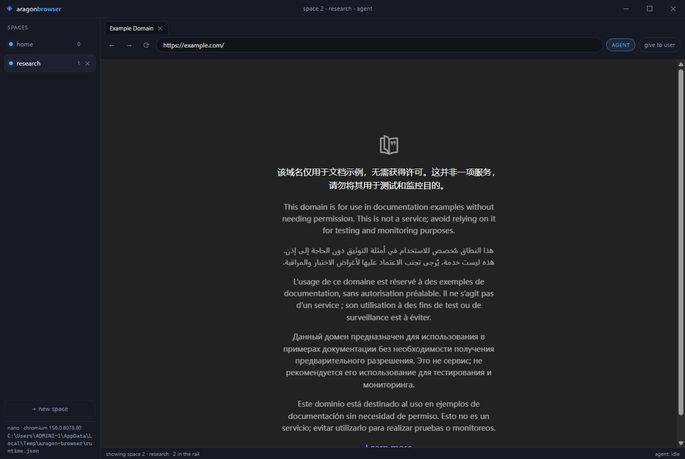

<div align="center">


# aragon-browser

**A nano browser that an AI agent drives by writing JavaScript.**

Named after what it actually is: a browser with a patched **engine boundary**,
not a patched Chromium.

[](LICENSE) [](https://github.com/xdrshjr/aragon-browser/releases/tag/v0.1.1) [](#下载安装) [](#诚实的边界) [](package.json)

[下载安装](#下载安装) · [30 秒上手](#30-秒上手) · [它改了什么](#诚实的边界) · [架构](#架构) · [已知限制](#已知限制)

</div>



<div align="center"><sub>一个窗口装下所有 space。左侧列表里的每个 space 有独立 cookie 分区，<code>AGENT</code> 标记当前由谁控制。</sub></div>

---

## 为什么存在

普通浏览器是给人点鼠标设计的。要让 agent 用它，你得让它截图、猜坐标、盲点。
这条路能跑通，但每一步都在赌：赌布局没变、赌元素没被遮挡、赌截图和点击之间没有重排。

aragon-browser 换掉了赌的那部分。agent 写的是一段 JavaScript，浏览器给它的是
**结构化快照**（带稳定 `@N` 引用）和**真实指针输入**（不是 `element.click()` 合成事件）。
同样一件事，从「找像素」变成「指名元素」。

```bash
aragon-browser nodejs -e "
const s = await taskSpace('demo');
const p = await s.newPage('https://example.com');
cliLog((await p.snapshot()).text);
"
```

```
# space 2 "demo" owner=agent url=https://example.com/
RootWebArea "Example Domain" [focused]
  heading "Example Domain" [level=1] @1
  link "More information..." @2
```

拿到 `@2`，就点 `@2`。不需要坐标，不需要等页面「看起来加载完了」。

---

## 下载安装

**[⚡ 下载最新版](https://github.com/xdrshjr/aragon-browser/releases/latest)** — Windows x64，装完即用，不需要 Node。

| 下载 | 大小 | 适合 |
|---|---:|---|
| `aragon-browser-0.1.1-x64.exe` | 116 MB | 日常使用。可选安装目录，建桌面/开始菜单快捷方式，可卸载 |
| `aragon-browser-0.1.1-portable.exe` | 106 MB | 免安装单文件。不写安装记录 |

> **没有代码签名。** Windows SmartScreen 会拦一次：点「更多信息」→「仍要运行」。
> 这是开源项目没有代码签名证书的诚实缺口，不是打包出错。

安装后：

1. `aragon-browser` 命令装进 `%LOCALAPPDATA%\aragon-browser\bin\`。优先用系统 Node，
   机器上没有 Node 时回落到 Electron 自带运行时。
2. agent skill 被复制进**已存在**的 agent 目录（`~/.claude/skills`、`~/.codex/skills`、
   `~/.cursor/skills`）。不存在的宿主不会被凭空创建。
3. `skills/aragon-browser/` 在安装目录的 `resources/skills/` 下，可直接编辑，不用解包 asar。

**PATH 不会被偷偷改。** 加入 PATH 是菜单里的一次显式操作（`File → Add CLI to PATH`），
首次运行只告诉你需要加哪一行。一个会在引导流程里静默改写用户环境的浏览器，和恶意软件没有区别。

### 从源码构建

```bash
npm install
npm start        # 开发模式启动
npm run dist     # 打包，产物在 dist/
```

---

## 30 秒上手

agent 通过 **stdin 收一段 JavaScript**，在已打开的浏览器里执行：

```bash
# 打开一个 space 和页面，拿结构化快照
aragon-browser nodejs -e "const s = await taskSpace('demo'); const p = await s.newPage('https://example.com'); cliLog((await p.snapshot()).text)"

# 用 @N 引用直接操作，不需要坐标
aragon-browser nodejs <<'JS'
const s = await taskSpace('demo');
const p = await s.page('p1');
await p.fill('@1', 'me@example.com');
await p.click('@2');
await p.waitForNavigation();
cliLog((await p.snapshot()).text);
JS
```

agent 自己找入口的路径是固定的：扫 `skills/*/SKILL.md` 的 frontmatter → 命中
`aragon-browser` → 读入口 skill → 按提示读 `aragon-browser skill` 拿全量 API。
`skills/` 目录是给 agent 的**入口**，不是给人看的文档堆放处。

---

## 诚实的边界

这个仓库叫 `aragon-browser`。**必须说清楚：没有改 Chromium 源码。**
本机没有 MSVC / depot_tools / Chromium 源码树，任何「重编译了内核」的说法都是空话。
它是一个跑在 Electron 二进制之上的浏览器，改造发生在**引擎与外部世界的五条边界**上，
每一条都在真实浏览器上被测试证明过：

| 边界 | 普通做法 | aragon-browser 的做法 | 证据 |
|---|---|---|---|
| **AX 树** | 原样丢 `Accessibility.getFullAXTree` | 重建成紧凑文本：presentation 折叠、重复文本合并、只给可操作节点发 `@N`、按 `loaderId` 分文档失效 | 单测 20 项 + smoke |
| **跨进程 iframe** | 按 URL/标题猜位置，或丢弃 | `DOM.getFrameOwner` 的 backendNodeId **精确插回 `<iframe>` 原位**；解析不出归属的帧**单独报告**，绝不静默丢失 | smoke：跨站 iframe 内 click 落点正确 |
| **输入事件** | `element.click()` / 合成 DOM 事件 | `Input.dispatchMouseEvent` 真实指针序列，坐标 = 节点矩形 + **逐层累计帧偏移** | smoke：`frame-clicked:9 9 9` |
| **元素寻址** | 只认 CSS | 完整 locator 语法：`@N`/`ref=N`、`css:`、`loc=role:[name*=]`、`text=`（引号区分大小写与子串）、`href:`（精确匹配）、`xpath=`、`>> nth=N`、`:has-text/:text-is`；**穿透 shadow DOM**；失败分 transient/permanent | 单测 14 项 + smoke 12 项 |
| **进程与存储隔离** | 所有标签共用一个 cookie 罐 | 每 Space 一个 `session.partition`，两 Space 同站点互不可见 | smoke：cookie 探测 |

这五条是「改过内核」的**真实内容**：它们改变引擎输出的形状、引擎接收输入的方式、
以及引擎对外寻址的能力，属于渲染器 / 无障碍 / CDP 这一层。它**不是** Blink 里的 C++ 补丁。

**能力差异，直说：**

- 快照能做到「结构化且省 token」，但**做不到** ego lite 那种「内核里定制过的快照」的
  极限质量。它受限于 Chromium 暴露的 AX 树。
- 没有自己的更新器、没有代码签名、没有自动安装 PATH 集成。
- Linux 未验证。只在 Windows x64 + Electron 45 上跑过全套。
- 安装包 100 MB 级别来自 Electron 本身（Chromium + Node），这是选这条路线的固定成本，
  不是打包没优化。

---

## 架构

```
aragon-browser <script>          ← 你 / 你的 agent
   │  stdin: JavaScript
   ▼
src/cli/                         客户端：注入 helpers，执行脚本
   │  NDJSON + per-launch token, 127.0.0.1:随机端口
   ▼
src/kernel/                      浏览器侧：RPC 方法表
   ├ browser-kernel.js           唯一的方法表（agent 面 / ui.* 面分开）
   ├ task-spaces.js              space / 标签 / 所有权 / session 分区
   ├ cdp-channel.js              CDP 会话拓扑 + 事件环形队列 + 对话框策略
   ├ locator.js         ← 纯函数  locator 语法、错误分类、匹配 JS 生成
   ├ element-resolver.js         运行时：把 locator 落到具体 session + backendNodeId
   ├ ax-snapshot.js     ← 纯函数  AX 树 → 紧凑文本 + ref
   ├ ref-registry.js    ← 纯函数  @N 稳定性与失效
   ├ actions.js                  真实指针 / 键盘，帧偏移累计
   ├ interactions.js             上传 / 剪贴板 / 拖拽
   ├ waits.js                    等待原语，只重试 transient
   ├ learning/          ← 大部分纯函数  站点技能的发现、校验、执行
   └ runtime-transport.js        服务端 socket + 坐标发布
   ▲
   │  electron IPC（只允许 ui.*）
src/renderer/                    界面：自绘标题栏 / 侧边栏 / 标签栏 / 地址栏 / handoff
```

标了「纯函数」的模块不碰 Electron，所以核心语义可以用普通 `node --test` 跑。
这是刻意的：locator 语义和 ref 语义是最容易出错、也最值钱的部分。

### 一个窗口，多个 space

`TaskSpaceManager` 只有一个 `BrowserWindow`，space 是窗口里的一组 `WebContentsView`；
侧边栏切换的是「窗口当前显示哪个 space」，不是「切到另一个窗口」。第二个 agent 用
`taskSpace('新名字')` 要空间时，它出现在同一个窗口的左侧列表里。

可见性是**算出来**的，不是存下来的：当前聚焦 space 的激活页签摆在页面区，其它页签
保留原尺寸但停在窗口外侧——不是 `setVisible(false)`。这是 smoke 测出来的真坑：
Chromium 对「不可见」的页面直接丢弃真实指针 / 键盘输入，页签被隐藏后 agent 点不动它。

焦点策略分两半：agent **新建 / 选中** space 时不动画面；一旦真的要**操作**某个 space
的页面，`activeTab()` 会把该 space 放到台前。隐藏的页面收不到真实输入，这是引擎的限制，
不是取舍。

### 页签生命周期：agent 开了就要关

一个页签是真实的浏览器状态，agent 不关它就一直在 space 和侧边栏里。所以分三层：
`page.close()` 关一个 / `space.finish({ keep: [] })` 关这个 space 的 agent 页签 /
CLI 在脚本结束时自动清扫「本次运行打开的、未被声明的」页签。用 `--keep-tabs`
（或 `ARAGON_KEEP_TABS=1`）关掉清扫，用 `page.keep()` 保留跨轮复用的那一个，
`space.handOff()` 把该 space 的页签整体交给人类。

### 窗口骨架：标题栏是自己画的

窗口是 `frame: false` 的无边框窗口，原生标题栏没有了，但所有看得见的东西都还在：

| 部分 | 谁画 | 说明 |
|---|---|---|
| 标题栏（34px） | renderer `#titlebar` | 应用图标 + 品牌名、`space <id> · <name> · <owner>`、右侧最小化 / 最大化-还原 / 关闭 |
| 标签栏 + 地址栏（78px） | renderer `#chrome` | 标签、前进后退、地址栏、AGENT / give to user |
| 页面视图 | `WebContentsView` | 位置由 `src/shared/layout.js` 的 `pageBounds()` 算，`y` 必须 ≥ 标题栏高度 |

几处不是装饰、是坑的地方：

- **按钮在拖拽区里**：`#titlebar` 是 `-webkit-app-region: drag`，`.win-controls` 必须
  `no-drag`，否则按钮点不动（能被拖，不能被点）。
- **只有按钮可以 `no-drag`**：`.tb-space` 曾经为了保住 tooltip 而设成 `no-drag`，可它是
  `flex: 1`，占满品牌名到按钮之间的全部空隙——结果整条标题栏只剩品牌名左边十几个像素能拖，
  其余地方 Windows 命中测试回的是 `HTCLIENT` 而不是 `HTCAPTION`。拖不动是真的，不是错觉。
  `test/titlebar.test.mjs` 现在断言**全表只有 `.win-controls` 一个 `no-drag`**，
  以后加控件想退出拖拽区，就得显式改这条断言。拖拽区里 tooltip 永远弹不出来，
  所以那个 `title` 也一并删了，空间全名在状态栏里重复一次。
- **页面视图会盖住标题栏**：`WebContentsView` 合成在窗口自己的 web contents 之上。
  `pageBounds()` 的 `y` 必须把 34px 标题栏算进去；`styles.css` 的 `--titlebar-height`
  和 `LAYOUT.titleBarHeight` 由 `test/titlebar.test.mjs` 盯着，drift 了就红。
- **一个按钮两种含义**：最大化和还原是同一个按钮，动作是「读当前状态再取反」，
  不是让渲染器猜自己该发哪个。
- **窗口标题不能被渲染器改**：`index.html` 的 `<title>` 会把 OS 窗口标题改成
  `aragon-browser`，和装好的构建撞名；`page-title-updated` 里 `preventDefault()`，
  标题始终由内核写成 `aragon-browser - <space> (#<id>)`。

### 侧边栏只放 space

左下角曾经有一块调试页脚，打印 `nano · chromium <版本>` 和 `runtime.json` 的**绝对路径**
（`C:\Users\<name>\AppData\Local\Temp\...`）。那是开发时的脚手架，却跟着构建一起发了出去：
对用浏览器的人来说没有任何意义，默认窗口宽度下还要折成三行。现在这两样东西只出现在
**stdout 启动日志**（`[aragon-browser] runtime listening on ...`）和 CLI 的 `version` 里，
不再画进窗口。`test/sidebar.test.mjs` 守着 `#engine` / `#runtime` / `.side-foot` 不会回来，
连 `aragon:state` 的 IPC 载荷里也不许再带这两个字段——没人读的字段就是它下次回来的方式。

### 为什么 Space 要用独立 partition

`persist:aragon-<profile>-space-<id>`。同站点在两个 space 里是两套 cookie，这是
「agent 后台干活、你前台浏览，互不打架」的**存储层保证**，不是 UI 装饰。
`ephemeral` profile 用 `aragon-mem-...`，不落盘。

### 为什么要单独处理 OOPIF

`Target.setAutoAttach` 只对**它之后**出现的 iframe 生效。如果页面已经加载完再 attach
（真实使用里几乎总是如此），跨站 iframe 在 CDP 里完全不可见，快照会静默缺少整块内容。
所以 `settleChildSessions()` 同时做两件事：显式 `Target.attachToTarget` 已知 iframe，
并等 `Target.attachedToTarget` 事件追上 `Target.getTargets` 的答案——这两者不同步是
真实存在的一类竞态。

另外踩到的一个真坑：Electron 给根会话传的 session id 是**空字符串**而不是 `undefined`，
`??` 会保留空串，导致子帧的 parent 变成 `""`（falsy），整块内容静默消失。现在用真值判断，
并且无法归属的帧会**单独报告**而不是消失。

### transient 与 permanent

这是整套设计里最容易被写反的一处：把缺失元素判成 permanent → 等待永远不重试，页面慢
一点就直接失败；把歧义判成 transient → 等待空转到超时，还掩盖了 bug。所以：

- 0 个匹配 → `transient`（可能还没加载）
- \>1 个匹配 → `permanent`（选择器本身有歧义）
- 语法错、ref 过期、跨文档 → `permanent`
- 节点不可见 / 零尺寸 / 被遮挡 → 重试仍按 transient 处理

`page.waitFor` 只重试 transient，smoke 里有一条断言专门测「歧义选择器 1ms 内失败」。

---

## 它怎么证明自己能用

```bash
npm test                 # 122 个单元测试
npm run smoke            # 53 项真浏览器端到端断言
npm run smoke:ui         # 10 项 UI / 布局 / 像素 / 历史 / 无边框窗口断言
npm run smoke:packaged   # 14 项针对打包产物的断言（含 skill 可被发现、asar 里的界面）
npm run validate:skills  # 站点技能格式校验
```

单测覆盖 locator 语法、快照、ref、learning 校验、skills 结构、传输、分区、窗口控制与
space 作用域。smoke 启动真的 Electron 窗口，起一个本地 fixture，然后通过 CLI 跑一段
agent 脚本——fixture 是刻意设计的，每一处都对应一个真实失败模式：

- iframe 走 `localhost` 而页面是 `127.0.0.1`，所以它是**真的跨站**（OOPIF），
  不是同源 frame 的假测试；
- 页面上有两个同名按钮，用来证明 `>> nth=N` 真的选了其中一个，而**不带 nth 的选择器
  会明确报错**而不是瞎点；
- 有一个 shadow-DOM 组件，`document.querySelectorAll` 看不见它，只有穿透 shadow 的
  locator 能点到；
- 有一个 `confirm()` 按钮，所以对话框处理不是纸上功能；
- 有一个 file input 和一个拖拽源/落区。

53 项断言覆盖：快照与 ref 稳定性、跨站 iframe 拍平、跨帧 fill/click 落点、真实点击
触发页面监听器、6 种 locator 语法、歧义选择器**快速失败**（~1ms，不是等到超时）、
缺失元素是 transient、对话框记录与恢复、文件上传（含坏路径必须报错）、拖拽、
剪贴板往返、6 种等待、`waitForNavigation` 能区分「真的导航了」和「什么都没发生」、
learning 发现 / 运行 / 校验、导航后 ref 失效、前进后退、cookie 隔离、控制权交接、
`finish()` 硬性要求 `keep`、**多个 space 仍然只有一个窗口**、**新建 space 不动画面而
操作时把它放到台前**，以及**脚本结束后它自己开的页签被清扫掉**。

> `smoke` 里「真实指针」那些断言依赖窗口能拿到前台焦点。在后台或无人值守地跑，Chromium
> 会把真实输入丢给不可见的页面，表现为偶发的 `click did not fire the page handler`。
> 这是引擎行为，不是随机 bug。

`ui-check.js` 另外断言页面视图几何、chrome 渲染、**系统级整窗截图**
（`webContents.capturePage()` 不合成子 `WebContentsView`，只用它会拍出黑色页面区——
这正是「看起来通过其实没证明」的坑），以及整页截图选项。

### 打包后才暴露的问题，都有测试守着

`npm run smoke:packaged` 跑的是**装好的构建**，不是源码树。它在开发过程中抓到过这些
只在打包后出现的问题：

- `app.isPackaged` 在 worker 上下文里不可靠 → 改用 `ARAGON_PACKAGED` 环境变量
- `runtime.version` 里返回了一个 Promise 字段，JSON 序列化会**静默吞掉**它
- esbuild 的 `inject` 只作用于模块作用域，CJS bundle 里的 `import.meta.url` 会直接抛
- `learnings` 从源码树能解析、打包后不行 → 改成按候选路径逐个探测
- 入口 `SKILL.md` 最初没有 YAML frontmatter，装进 `~/.claude/skills/` 也永远不会被
  agent 加载（CLI 能用，agent 只是不知道它存在）→ 补 frontmatter，并加两条测试守着
- 首次运行写 agent skill 时用了 `os.homedir()`，测试污染了开发者自己的 `~/.claude`
  和 `~/.codex` → 改成可重定向的 home 解析，测试里正面断言 skill 落在了重定向目录

界面这一层也归它管了：`smoke:packaged` 现在直接用 `@electron/asar` 把封装好的
`app.asar` 里的 `index.html` / `styles.css` / `ui.js` / `brand.png` **抽出来**验证——
标题栏用的是应用图标（不是占位字形）、`no-drag` 只出现在窗口按钮上、侧边栏没有
engine / runtime-path 页脚。理由是这三个问题的报告都来自**装好的构建**：
源码树改对了、`dist/` 还是旧的，正是它们当初被发出去的方式。

---

## API 表面

完整清单读 `aragon-browser help-api` 或 `aragon-browser skill`。那份文档是**从
`src/shared/public-api-schema.js` 渲染**的，不是抄的，所以不会和运行时漂移。

```
spaces   taskSpace / createTaskSpace / claimTaskSpace / listTaskSpaces
         useTaskSpace / takeOverTaskSpace / closeTaskSpace
         space.pages / tabs / newPage / page(label) / handOff / finish / close / waitForControl / learn
observe  page.snapshot / info / frames / screenshot / events / dialogs
act      page.click / doubleClick / rightClick / fill / type / press / hover
         page.scroll / drag / upload / clipboard / readClipboard
         page.goto / goBack / goForward / reload
         page.close / page.keep          ← 页签生命周期（用完就关）
wait     page.waitFor / waitForText / waitForExpression / waitForLoad
         page.waitForNetworkIdle / waitForDialog
dialogs  page.answerDialog / setDialogPolicy / dialogs
verify   page.evaluate / cdp / sendCDPMessage
learn    page.learn / runSiteTool / runSiteBrowserTool / learnContext / validateSiteSkills
```

Targets：`@N`、`ref=N`、`css:<sel>`、`loc=role:<role>[name=…]`、`text=…`、`href:<path>`、
`xpath=<expr>`、`<css> >> nth=N`、`:has-text/:text-is`。

错误码沿用 ego lite 命名（`EGO_TASK_SPACE_USER_IN_CONTROL`、`EGO_CDP_SEND_FAILED`…），
自有扩展用 `ARAGON_` 前缀。

---

## 应用图标

`build/icon.png` 是桌面端唯一生效的图标：`electron-builder.yml` 的 win / mac / linux
三处都指向它，所以安装包、免安装版和窗口图标是同一张图。

`npm run build` 会先跑 `npm run icon`，而这个脚本**不会覆盖已存在的图标**（只有显式
`--force` 才会）——否则每次打包都会把它换回占位菱形。全新 clone 没有图标时，它仍然
负责生成一个占位图，免得打包直接失败。

### 标题栏里的图标也是它

标题栏左边那个图标不是打出来的符号，是 `build/icon.png` 等比缩到 18px 的副本：
`npm run brand` 把它缩成 `src/renderer/brand.png`（64px，几 KB）。标题栏以前画的是 `◈`，
而 `◈` 恰好是 `make-icon.mjs` 画的**占位菱形**——于是装好的构建里，窗口左上角的形状和
任务栏、安装包、exe 上的那张图毫无关系。这类「源码里看着没事、装完才发现不对」的偏差，
现在由两条断言堵住：一条比对 `brand.png` 与 `build/icon.png` 缩放后的字节（drift 就红），
一条由 `npm run smoke:packaged` 直接从 **app.asar 里**把 HTML/CSS/PNG 抽出来验。

为什么不在 `` 里直接指 `build/icon.png`：那是 1254×1254、1.2 MB，为了 16px 的图标
每次开窗解一遍一百万像素不划算；而且它不在 asar 里。缩放用 `scripts/png.mjs`（zlib 手写，
premultiplied 面积平均，透明边缘不会渗黑），不引入 sharp/canvas 这种原生依赖——这也是
图标流水线一直是代码而不是一堆检查进仓库的缩略图的原因。

出图流水线与设计规范在 `scripts/gen-icons.mjs` 与 `scripts/icon-brief.md`。那份规范
记录了提示词里**不能写什么**：写出公司名会被直接复刻，写出不想要的材料名会被当成点单。

---

## 已知限制

- **没有内核级快照定制**：受限于 Chromium 暴露的 AX 树，质量上限低于 ego lite。
- **没有 Downloads / 扩展 / 书签 / PDF**。
- **没有代码签名与自动更新**：安装包会被 SmartScreen 拦一次。
- **Linux 未验证**。
- 页面仍可用自己的 DOM 原型干扰 locator 求值（我们在同源世界执行）。ego lite 用
  isolated world 规避，这里没做——不掩饰这一点。
- `about:blank` 快照为空，此时应直接 `goto`。
- SPA 内部路由不改 `loaderId`，ref 不会失效——这是对的；但若 DOM 整体重建而文档未变，
  ref 可能指向新内容，此时重新快照。
- 对话框默认 `dismiss`；需要 `confirm()` 返回 true 的场景要显式
  `setDialogPolicy('accept')` 或 `answerDialog({ accept: true })`。
- **点击后要导航的话必须用 `waitForNavigation`**，不是 `waitForLoad`：旧文档已经是
  `complete`，`waitForLoad` 会立刻返回，你读到的是刚要离开的那个页面。
- `taskSpace(name)` **会切换全局选中空间**，后面的裸 helper（`snapshot`、`listTabs`、
  `runSiteTool`）会跟着变。多空间脚本里要么用完切回来，要么一直用 `space.xxx` 形式。
- 空间共享一个窗口，所以窗口级截图（`captureWindow` / `captureChrome`）会先把该空间
  切到前面来——只有当前聚焦空间的页签会被合成进窗口。

---

<div align="center"><sub>

MIT Licensed · 基于 Electron 45 / Chromium 156 · 不包含任何被修改的 Chromium 源码

</sub></div>
